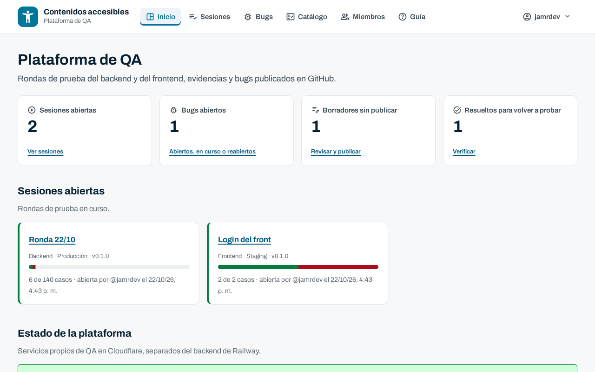
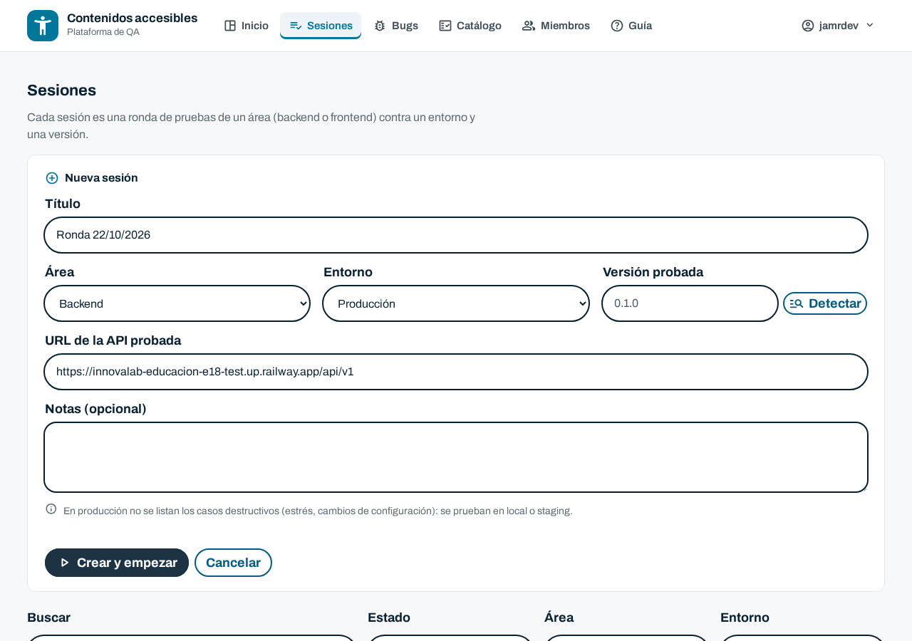
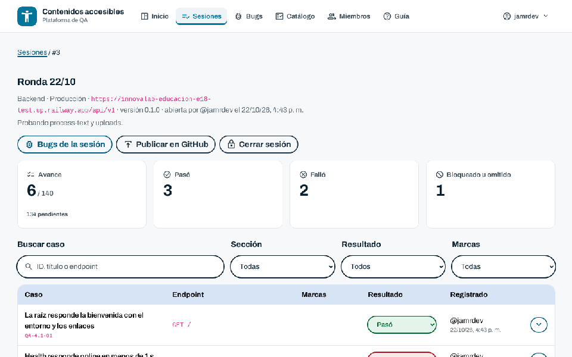
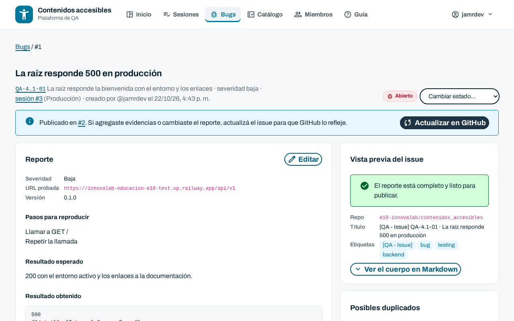
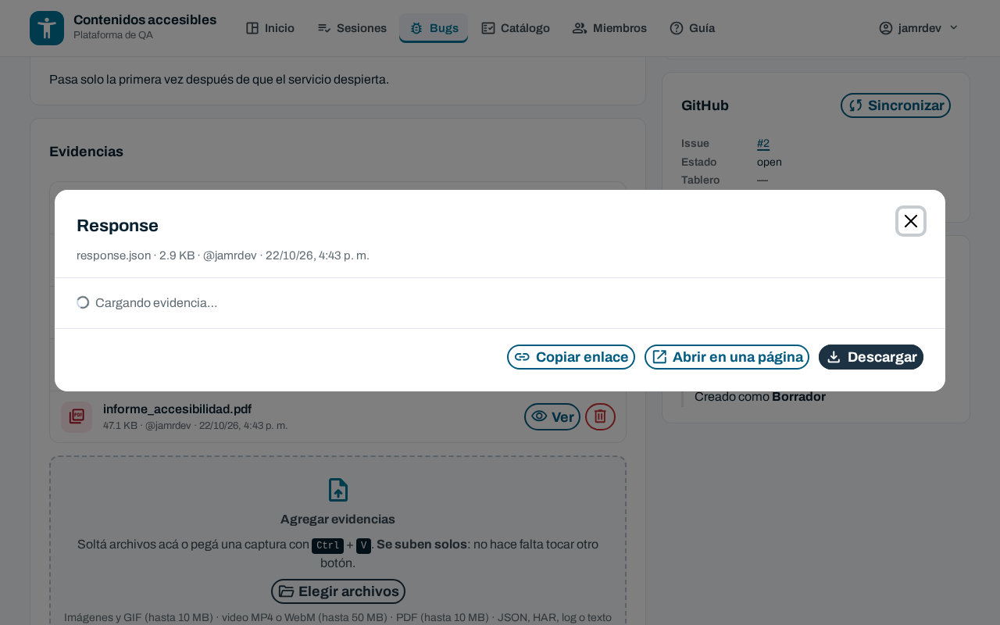
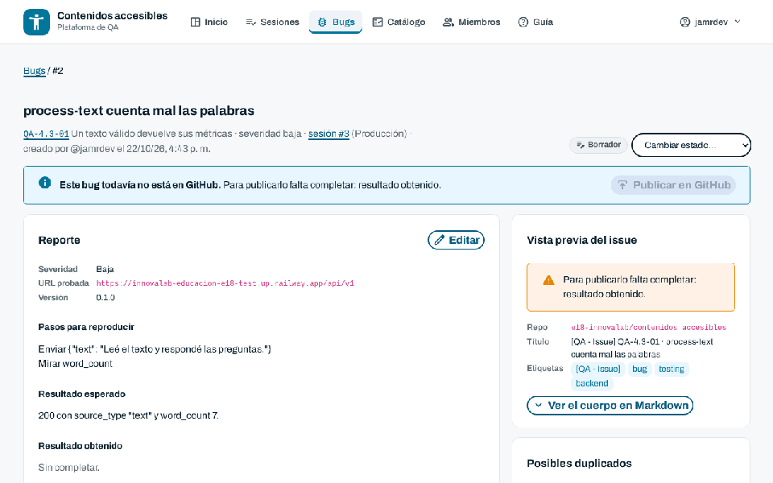
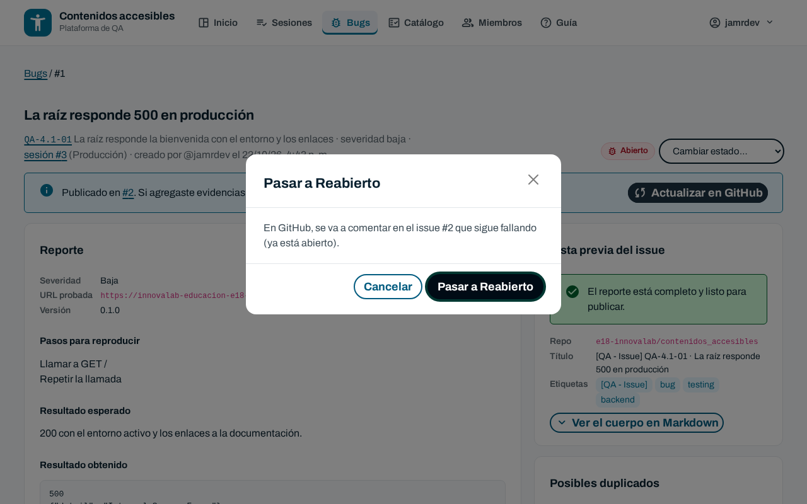
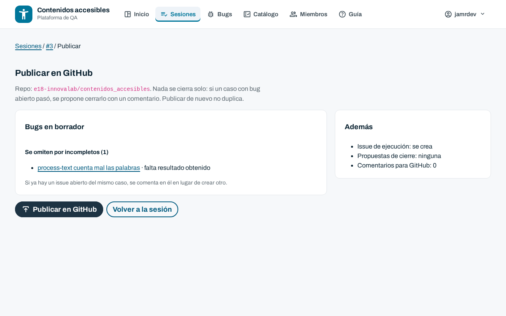
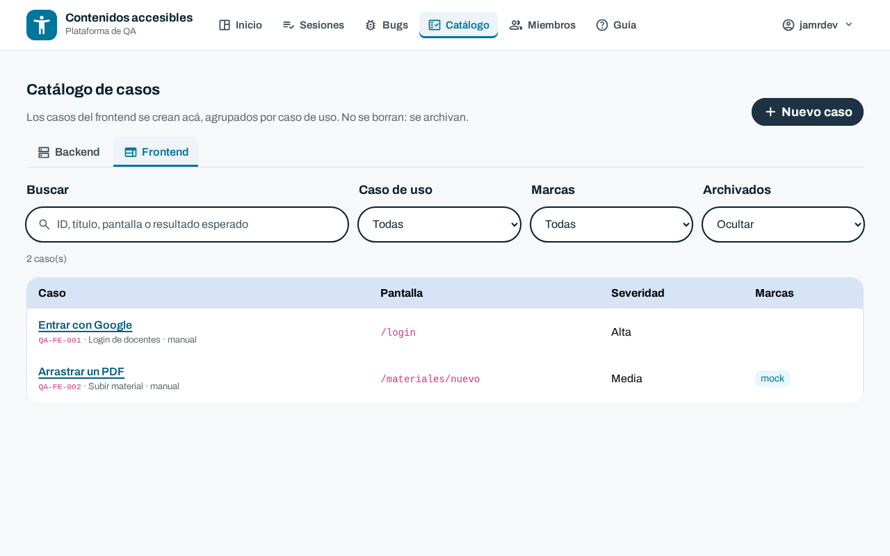
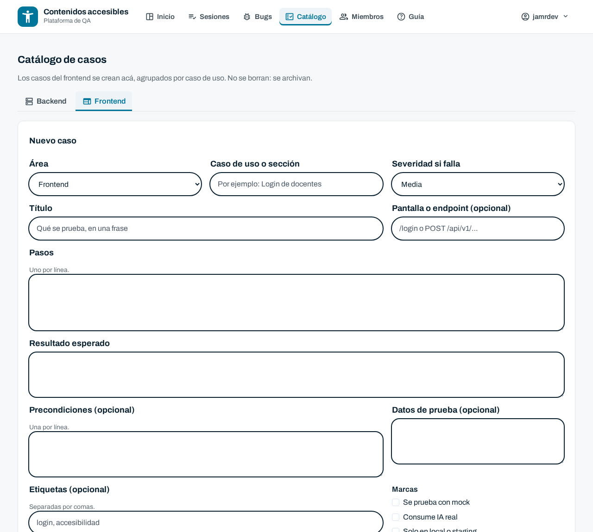

# Cómo usar la plataforma de QA

Guía rápida para quienes prueban el backend y el frontend de Contenidos accesibles. En pocos minutos vas a saber cómo registrar una ronda de pruebas, cargar evidencias y mandar los bugs a GitHub.

> No hace falta saber programar ni manejar GitHub: la plataforma arma los issues por vos.

## 1. Entrar

1. Abrí la plataforma y tocá **Iniciar sesión**. Se entra con la cuenta de GitHub, la misma del panel de administración.
2. Si ves **Sin acceso**, pedile a un admin que te agregue en **Miembros** con tu usuario de GitHub.

Hay tres roles:

- **Solo lectura**: ve todo, no cambia nada.
- **QA**: registra resultados, carga evidencias y publica bugs.
- **Admin**: además da y quita accesos.

En **Inicio** tenés el resumen: sesiones abiertas, bugs abiertos, borradores sin publicar y bugs resueltos que hay que volver a probar.

## 2. Crear una sesión

Una **sesión** es una ronda de pruebas: un área (backend o frontend), un entorno y una versión.

1. Andá a **Sesiones** y tocá **Nueva sesión**.
2. Elegí el **área** y el **entorno**. Con **Detectar** se completa la versión que está publicada.
3. Revisá la URL probada y tocá **Crear y empezar**.

> En producción no aparecen los casos destructivos (estrés, cambios de configuración): esos se prueban en local o staging.

## 3. Probar los casos

La sesión lista los casos del catálogo para esa área. Para cada uno:

1. Abrí la fila para ver los **pasos** y el **resultado esperado**.
2. Hacé la prueba y elegí el resultado: **Pasó**, **Falló**, **Bloqueado** u **Omitido**.
3. Si falló, la fila se abre sola: escribí en **Notas del resultado** lo que obtuviste (código HTTP, mensaje, qué viste en pantalla) y tocá **Guardar notas**.

Usá los filtros de arriba de la tabla para ver solo los pendientes, los fallidos o una sección.

### Evidencias

Debajo de las notas está la zona de **Agregar evidencias**:

- **Arrastrá archivos** o **pegá una captura** con `Ctrl` + `V`. **Se suben solos**, no hay que tocar otro botón.
- Se aceptan imágenes y GIF, videos MP4 o WebM, PDF y archivos de texto (JSON, HAR, logs).
- Para un request, un response, un curl o la consola, pegá el texto en **O pegá texto**, elegí qué es y tocá **Agregar texto**.

Cada evidencia queda como una fila. Con **Ver** se abre en una ventana: el código se ve como código, el video se reproduce, la imagen y el PDF se muestran tal cual.

> Los tokens, cookies, claves y firmas de URL se ocultan antes de guardar. Igual, evitá subir datos personales reales.

## 4. Reportar un bug

1. En un caso fallido, tocá **Crear bug**. Queda como **Borrador**, todavía no está en GitHub.
2. En el bug, tocá **Editar** en el reporte y completá lo que falte: pasos, resultado esperado y **resultado obtenido**.
3. A la derecha está la **Vista previa del issue** (cómo va a quedar en GitHub) y los **Posibles duplicados**. Si ya existe un issue del mismo problema, no crees otro.
4. Tocá **Publicar en GitHub** y confirmá. El issue se crea con la etiqueta `[QA - Issue]` y un enlace de vuelta a la plataforma.

Si después agregás evidencias o cambiás el reporte, tocá **Actualizar en GitHub** para que el issue quede al día. Publicar de nuevo nunca duplica el issue.

## 5. Seguir un bug

En **Bugs** están todos, con filtros por estado, área y severidad. Los estados son:

- **Borrador**: todavía no se publicó.
- **Abierto**: publicado en GitHub.
- **En curso**: alguien lo está arreglando.
- **Resuelto**: se cerró en GitHub. Hay que volver a probarlo.
- **Verificado**: QA lo volvió a probar y anda.
- **Reabierto**: se volvió a probar y sigue fallando.
- **Descartado**: no era un bug o era un duplicado.

Para cambiar el estado usá **Cambiar estado**. Antes de aplicarlo, la plataforma te dice qué va a pasar en GitHub (por ejemplo, reabrir el issue o dejar un comentario).

Lo que pasa en GitHub también llega a la plataforma: si alguien cierra o reabre el issue, o deja un comentario, se ve acá en unos minutos. Al abrir un bug se trae lo último de GitHub, y también podés tocar **Sincronizar con GitHub**.

En la sección **Comentarios** de cada bug podés dejar notas. Quedan solo en la plataforma, salvo que marques **Publicarlo también en el issue de GitHub**.

## 6. Cerrar y publicar la sesión

Cuando terminaste la ronda, tocá **Publicar en GitHub** en la sesión. Antes de publicar ves qué va a pasar:

- Qué bugs en borrador se publican y cuáles se omiten porque les falta algo.
- Si se crea el issue con el resumen de la ejecución.
- Si algún caso con bug abierto ahora pasó: en ese caso se propone cerrarlo con un comentario. **Nada se cierra solo.**

## 7. Agregar casos al catálogo

En **Catálogo** están todos los casos, separados por área. Para el frontend o para algo que el catálogo no cubre, tocá **Nuevo caso** y completá título, sección, pasos y resultado esperado. El caso aparece en las sesiones nuevas de esa área.

Si un caso ya no aplica, **archivalo** en lugar de borrarlo: así se conserva el historial de resultados.

## Buenas prácticas

- **Un bug, un problema.** Si encontrás dos cosas distintas, son dos bugs.
- **Pasos que cualquiera pueda repetir.** Escribí lo que hiciste, en orden, con los datos que usaste.
- **Siempre con evidencia.** Una captura, un video o el response valen más que una descripción.
- **Revisá los posibles duplicados** antes de publicar.
- **Volvé a probar los resueltos.** Pasalos a Verificado si anda o a Reabierto si sigue fallando.

## Preguntas frecuentes

### ¿Se pierde algo si cierro la pestaña?

No. Los resultados y las evidencias se guardan al momento. Las notas, cuando tocás **Guardar notas**.

### ¿Puedo publicar un bug sin todos los campos?

No. La vista previa te dice qué falta antes de publicar.

### Cambié algo en GitHub y no lo veo en la plataforma.

La sincronización corre cada 10 minutos. Abrí el bug o tocá **Sincronizar con GitHub** para traerlo ya.

### ¿Quién ve mis comentarios?

Solo quienes tienen acceso a la plataforma, salvo que marques que se publiquen en el issue de GitHub.
